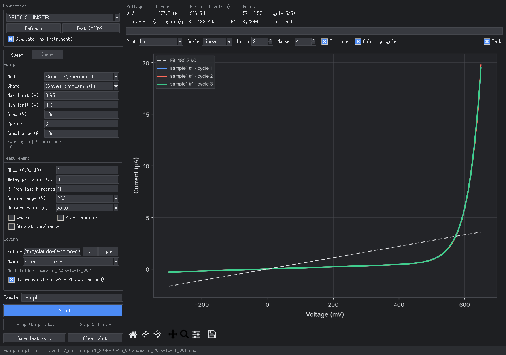
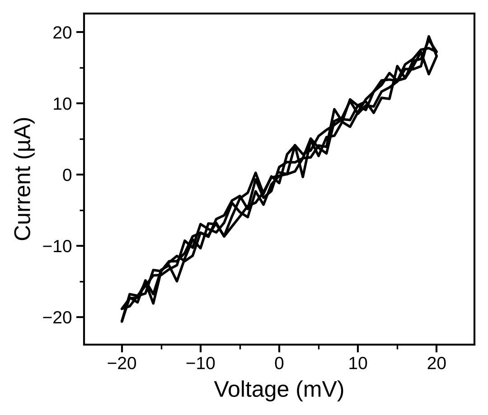

# Keithley 2400 I-V Measurement App

Desktop program for I-V and constant-source measurements with a **Keithley 2400 SourceMeter**
over GPIB (tested setup: NI GPIB-USB-HS). Live plot, live saving, measurement queue, and
publication-ready figures.



## Features

- **Sweep shapes:** single, double (forward + reverse), bipolar, **cycles** (0 → max → min → 0, repeated N times), and **constant source vs time**
- **Source V / measure I** or **source I / measure V**
- **Live readout:** voltage, current, resistance (fit over the last N points), plus a whole-run linear fit with **R and R²**
- **Fixed or auto range** for both source and measurement
- **Queue:** chain sweeps, constant-bias steps and waits, and repeat the whole queue
- **Live saving:** every point is written to the CSV as it is measured. Nothing is lost if the PC crashes
- **One folder per measurement**, with a choice of naming schemes (or your own pattern)
- **Stop & discard:** stop a measurement and delete its data in one click
- **Plot options:** line / scatter / both, line width, marker size, linear / log |y| / log-log, colour by cycle, dark or light theme
- **Publication-style PNG** with automatic SI units (mV, µA, …):



- **Safety:** the output is switched off at the end of every run, on Stop, on errors and when closing the app. Instrument errors are read back and shown.

## Quick start (exe)

1. Install the **NI-488.2** driver from [ni.com](https://www.ni.com/) (needed for the GPIB-USB-HS; admin rights required).
2. Download `KeithleyIV.exe` from the **[Releases](../../releases)** page. No Python needed.
3. Connect the GPIB-USB-HS and turn on the 2400 (MENU → COMMUNICATION → GPIB, default address 24).
4. Open the app → **Refresh** → **Test (*IDN?)** → set up a sweep → **Start**.

Tick **Simulate** to try the app without an instrument.

## Run from source

```
py -m pip install --user pyvisa numpy matplotlib
pyw keithley2400_gui.pyw
```

To build the exe yourself on Windows, double-click `build_exe.bat` (result: `dist\KeithleyIV.exe`).

## Tips

**Number input.** All fields accept `0.1`, `1e-1`, `100m`, `100 mV`, `10u`, `10µA` and `2k`.
Lowercase `m` means milli and capital `M` means mega. Durations (constant mode, queue waits) accept
`90`, `90 s`, `500 ms`, `10 min` and `1.5 h`.

**NPLC.** This is the integration time in power-line cycles (1 = 20 ms at 50 Hz). Use a higher value
for less noise and a lower value for faster sweeps.

**Fixed range.** Choose the smallest range above your largest expected value (e.g. ~20 µA max → 100 µA range).
This avoids small jumps in the curve when auto-range switches. If compliance is above a fixed
measure range, the 2400 limits at the range value.

**Queue.** Set up a measurement in the Sweep tab, then in the Queue tab click
*Add current Sweep-tab settings*. Add waits between steps if needed, and set *Repeat*. Double-click a step to
load its settings back for editing. Queue results are always saved, in their own `Queue_<date>_<time>` folder.

**Stopping.** *Stop (keep data)* ends the measurement and saves what was measured. *Stop & discard* ends it
and deletes its data. In a queue, it stops the queue and deletes only the measurement that was running.

## Data files

Each measurement gets its own folder inside the data folder (**Saving** section of the Sweep tab,
default `~/IV_data`), containing `<name>.csv` and `<name>.png`. Queue runs go into a `Queue_<date>_<time>` folder:

```
IV_data/
├── sample1_2026-10-15_001/
│   ├── sample1_2026-10-15_001.csv
│   └── sample1_2026-10-15_001.png
├── sample1_2026-10-15_002/
└── Queue_2026-10-15_14-30-00/
    ├── sample1_2026-10-15_001/
    └── sample1_2026-10-15_002/
```

**Naming schemes** (chosen under *Names*; the next name is previewed in the app):

| scheme | example |
|---|---|
| Sample_Date_# | `sample1_2026-10-15_001` |
| Sample_Type_Date_# | `sample1_IV_2026-10-15_001` |
| Date_Sample_# | `2026-10-15_sample1_001` (sorts by date) |
| Sample_Date_Time | `sample1_2026-10-15_14-32-05` |
| Sample_Type_Range_Date_# | `sample1_IV_-20mV_20mV_2026-10-15_001` |
| Sample_# | `sample1_001` |
| Custom pattern | any mix of `{sample}` `{date}` `{time}` `{n}` `{type}` `{range}` |

`#` / `{n}` counts up per name (001, 002, …). `{type}` is `IV` (voltage sweep), `VI` (current sweep),
`IVcyc` (cycles), `IT` / `VT` (constant source vs time). `{range}` is the sweep range, for example `-20mV_20mV`,
`1V_-1V_x3` (cycles) or `10mV_10min` (constant).

Header lines start with `#` and record the instrument, date, sample and all settings. Columns:

| column | meaning |
|---|---|
| `index` | point number |
| `time_s` | time since the start of the run |
| `source` | programmed source value (V or A, see header) |
| `voltage_V`, `current_A` | measured values (empty = over range) |
| `compliance` | 1 if the point hit compliance |
| `cycle` | cycle number (cycle sweeps) |
| `resistance_ohm` | R from a fit over the last N points |
| `over_range` | 1 if the reading was above the fixed measure range |

## Troubleshooting

- **"VISA not available"**: install NI-488.2.
- **Timeout / instrument not found**: check that the 2400 is on, set to GPIB, and that the address matches. Click Refresh.
- **App does not open**: errors are written to `keithley_iv_errors.log` next to the exe (or the script).
- **Antivirus blocks the exe**: PyInstaller exes are sometimes falsely flagged. Allow the file, or ask IT to whitelist it.

Settings and the queue are stored per Windows user in `~/.keithley_iv_settings.json`.

## Disclaimer

This program was made for my own needs, based on my own experience. I make no claims about it
compared with any other programs, and I have no knowledge of whether other systems or programs,
which may serve larger or smaller purposes, are better or worse.

## How it was built

This app was built step by step with Claude (an AI assistant), using plain-language requests.
See **[HOW_IT_WAS_BUILT.md](HOW_IT_WAS_BUILT.md)** for a summary of every request and what it added.
